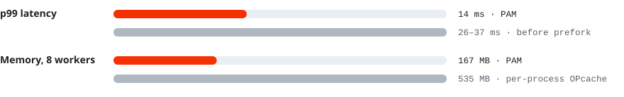
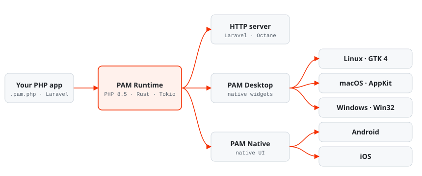

<div align="center">

<picture>
  <source media="(prefers-color-scheme: dark)" srcset=".github/assets/orbit-dark.svg">
  
</picture>

<p><picture>
  <source media="(prefers-color-scheme: dark)" srcset=".github/assets/pam-wordmark-dark.svg">
  
</picture></p>

# The native runtime for PHP.

**Servers, desktop and mobile from one PHP codebase.**<br>
No Electron. No Node. No browser in the middle.

[](https://github.com/push-in/pam/releases/latest)
[](https://packagist.org/packages/pushinbr/pam-desktop)

[](https://github.com/push-in/pam/actions/workflows/ci.yml)
[](LICENSE)

[Quick start](#quick-start) · [Docs](https://push-in.github.io/pam-docs/introduction/) · [Benchmarks](#why-pam) · [Ecosystem](#ecosystem) · [Community](#community)

</div>

<a id="see-it-launch"></a>
## <picture></picture> See it launch

<p align="center">
<picture>
  <source media="(prefers-color-scheme: dark)" srcset=".github/assets/launch-dark.svg">
  
</picture>
<br><sub>Cold start of the same app on the same machine, in real time.</sub>
</p>

<a id="why-pam"></a>
## <picture></picture> Why PAM

<div align="center">

| Same POS app, same machine | PAM Desktop | Electron | |
| --- | --- | --- | --- |
| App launch | **138 ms** | 1,563 ms | **11× faster** |
| Screen change | **41 ms** | 322 ms | **8× faster** |
| Idle memory | **75 MB** | 322 MB | **4× less** |
| Idle CPU | **0.2%** | 1.9% | **10× less** |
| Package | **120 MB** | 468 MB | **4× smaller** |

</div>

<a id="pixel-identical-to-chromium"></a>
## <picture></picture> Pixel-identical to Chromium

We rewrote a 37-screen Electron point-of-sale app in PAM Desktop and diffed every screen against the original. Mean difference: **below 0.5 out of 255** per pixel, on Linux and macOS.

<a id="server"></a>
## <picture></picture> Server

PAM Runtime serves Laravel and plain PHP from preforked workers with a shared OPcache. Against FrankenPHP and OpenSwoole it won **11 of 12** throughput scenarios.

<picture>
  <source media="(prefers-color-scheme: dark)" srcset=".github/assets/server-benchmark-dark.svg">
  
</picture>

<sub>Reproduce it with the [benchmark protocol](benchmarks/README.md).</sub>

<a id="how-it-works"></a>
## <picture></picture> How it works

<picture>
  <source media="(prefers-color-scheme: dark)" srcset=".github/assets/architecture-dark.svg">
  
</picture>

<sub>Internals: [Architecture](docs/architecture.md) · [Async runtime](docs/async-runtime.md) · [Native API](docs/native-api.md) · [Runtime overview](docs/overview.md)</sub>

<a id="quick-start"></a>
## <picture></picture> Quick start

```sh
# 1. install PAM (one time)
curl -fsSL https://github.com/push-in/pam/releases/latest/download/install.sh | sh
```

<sub>`pam` lands in `~/.local/bin` (add it to `PATH` if needed). There is no `php` on `PATH`: use `pam script.php` and `pam composer ...`. Desktop apps on Debian/Ubuntu need GTK 4: `sudo apt install libgtk-4-1 gstreamer1.0-plugins-good`.</sub>

<details open>
<summary><b>Desktop app</b> · Linux, macOS, Windows</summary>

```sh
pam init my-app --template desktop
cd my-app && pam desktop dev
```

</details>

<details>
<summary><b>Mobile app</b> · Android, iOS</summary>

```sh
pam init my-app --template native-ui --platform all
cd my-app && pam mobile dev
```

</details>

<details>
<summary><b>Laravel</b></summary>

```sh
pam init my-app --template laravel
cd my-app && pam dev
```

</details>

<details>
<summary><b>HTTP API</b></summary>

```sh
pam init my-api --template http
cd my-api && pam dev
```

</details>

```html
<Column class="card">
  <Text class="title">Hello, {{ $name }}</Text>
  <Button on:press="greet">Click</Button>
</Column>
```

<sub>Next: [Getting started](docs/getting-started.md) · [CLI reference](docs/cli-reference.md) · [Production](docs/production.md)</sub>

<a id="how-it-compares"></a>
## <picture></picture> How it compares

<div align="center">

| | PAM | Electron | Tauri | NativePHP | FrankenPHP |
| --- | :---: | :---: | :---: | :---: | :---: |
| Write it in PHP | ✓ | — | — | ✓ | ✓ |
| No embedded browser | ✓ | — | — | — | — |
| Desktop | ✓ | ✓ | ✓ | ✓ | — |
| Mobile | ✓ | — | ✓ | ✓ | — |
| HTTP server | ✓ | — | — | — | ✓ |

<sub>Based on each project's public docs, November 2026.</sub>

</div>

<a id="ecosystem"></a>
## <picture></picture> Ecosystem

**47 public PAM Native plugins**, listed in the [ecosystem catalog](config/ecosystem-packages.json):

| Area | Plugins (`pushinbr/pam-native-*`) |
| --- | --- |
| UI and graphics | [ui](https://github.com/push-in/pam-native-ui) · [drawer](https://github.com/push-in/pam-native-drawer) · [toast](https://github.com/push-in/pam-native-toast) · [webview](https://github.com/push-in/pam-native-webview) · [canvas](https://github.com/push-in/pam-native-canvas) · [charts](https://github.com/push-in/pam-native-charts) · [svg](https://github.com/push-in/pam-native-svg) · [3d](https://github.com/push-in/pam-native-3d) · [gpu](https://github.com/push-in/pam-native-gpu) · [lottie](https://github.com/push-in/pam-native-lottie) · [image](https://github.com/push-in/pam-native-image) · [maps](https://github.com/push-in/pam-native-maps) · [i18n](https://github.com/push-in/pam-native-i18n) |
| Camera and media | [camera](https://github.com/push-in/pam-native-camera) · [scanner](https://github.com/push-in/pam-native-scanner) · [media](https://github.com/push-in/pam-native-media) · [video](https://github.com/push-in/pam-native-video) · [audio](https://github.com/push-in/pam-native-audio) · [background-transfer](https://github.com/push-in/pam-native-background-transfer) · [share-extension](https://github.com/push-in/pam-native-share-extension) |
| Device and OS | [bluetooth](https://github.com/push-in/pam-native-bluetooth) · [nfc](https://github.com/push-in/pam-native-nfc) · [location](https://github.com/push-in/pam-native-location) · [sensors](https://github.com/push-in/pam-native-sensors) · [contacts](https://github.com/push-in/pam-native-contacts) · [notifications](https://github.com/push-in/pam-native-notifications) · [health](https://github.com/push-in/pam-native-health) · [intents](https://github.com/push-in/pam-native-intents) · [widgets](https://github.com/push-in/pam-native-widgets) · [live-activities](https://github.com/push-in/pam-native-live-activities) · [calls](https://github.com/push-in/pam-native-calls) |
| Data and realtime | [php](https://github.com/push-in/pam-native-php) · [nitro](https://github.com/push-in/pam-native-nitro) · [sync](https://github.com/push-in/pam-native-sync) · [sync-laravel](https://github.com/push-in/pam-native-sync-laravel) · [realtime](https://github.com/push-in/pam-native-realtime) · [webrtc](https://github.com/push-in/pam-native-webrtc) |
| Identity and commerce | [auth](https://github.com/push-in/pam-native-auth) · [payments](https://github.com/push-in/pam-native-payments) · [subscriptions](https://github.com/push-in/pam-native-subscriptions) |
| Operations and quality | [observability](https://github.com/push-in/pam-native-observability) · [analytics](https://github.com/push-in/pam-native-analytics) · [firebase](https://github.com/push-in/pam-native-firebase) · [feature-flags](https://github.com/push-in/pam-native-feature-flags) · [devtools](https://github.com/push-in/pam-native-devtools) · [testing](https://github.com/push-in/pam-native-testing) · [plugin-kit](https://github.com/push-in/pam-native-plugin-kit) |

<sub>Hosts and frameworks: [pam-desktop](https://github.com/push-in/pam-desktop) · [pam-native](https://github.com/push-in/pam-native) · [pam-laravel](https://github.com/push-in/pam-laravel) · [pam-http](packages/http) · [pam-socket](packages/socket) · [pam-octane](packages/octane). Full contract in [docs/ecosystem.md](docs/ecosystem.md).</sub>

<a id="community"></a>
## <picture></picture> Community

| [**Docs**](https://push-in.github.io/pam-docs/introduction/) | [**Discussions**](https://github.com/push-in/pam/discussions) | [**Contributing**](CONTRIBUTING.md) |
| --- | --- | --- |
| Guides, API and recipes | Ask, share, show what you built | How to set up, test and send a change |

<sub>Also: [Issues](https://github.com/push-in/pam/issues) · [Support](SUPPORT.md) · [Security](SECURITY.md) · [Governance](GOVERNANCE.md) · [Roadmap](ROADMAP.md) · [Changelog](CHANGELOG.md)</sub>

<p align="center">
  <picture>
    <source media="(prefers-color-scheme: dark)" srcset="https://api.star-history.com/svg?repos=push-in/pam&type=Date&theme=dark">
    
  </picture>
</p>

<p align="center">If PAM saves you time, <b>leave a star</b>. It helps more people find it.</p>

<p align="center"><sub><a href="LICENSE">Apache License 2.0</a> · <a href="LICENSING.md">licensing guide</a> · Made in Brazil by Pushin</sub></p>
