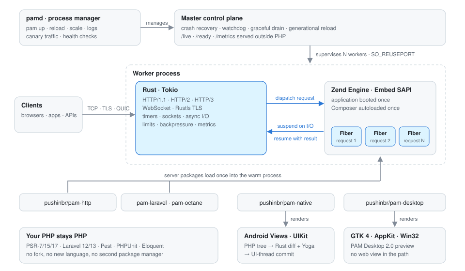
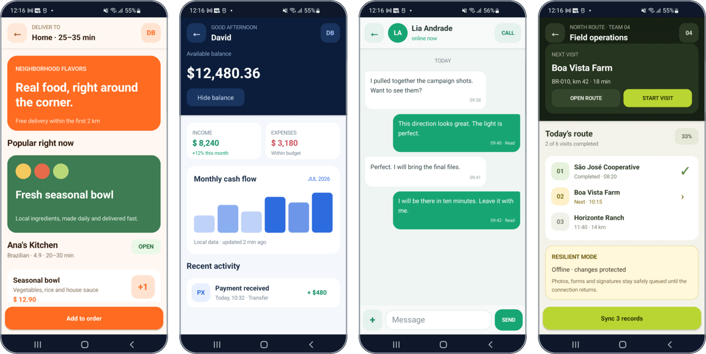

# PAM runtime overview

The in-depth tour of PAM Runtime that used to live in the repository README: what it is, how it works, and what ships in each layer. Start with the [README](../README.md) for the quick start.

## Why this exists

Classic PHP boots the interpreter, loads Composer, builds your framework, runs one
request and throws it all away. Then it does it again.

**PAM keeps it.** The Zend Engine and your Composer application boot once inside a
supervised Rust + Tokio process. Rust handles the network, timers, TLS and async I/O.
Each request runs in its own PHP Fiber against an application that is already warm.
The same runtime then powers native Android, iOS and desktop apps written in PHP.

It is **not** a PHP fork, a new language or a Composer replacement. Composer stays
Composer. Laravel stays Laravel. Your code stays PHP.

## What you can build

| | |
| --- | --- |
| **APIs and services** | HTTP/1.1, HTTP/2, HTTP/3 and WebSocket on one port, with TLS, limits and metrics built in |
| **Laravel without PHP-FPM** | A warm Laravel kernel with per-request sandboxes, or your existing Octane app on PAM's transport |
| **Production clusters** | A pm2-style manager with zero-downtime reload, canary traffic, health checks and rollback |
| **Android and iOS apps** | Real Android Views and UIKit controls driven by PHP components, with no JavaScript runtime and no web view |
| **Desktop apps** | Self-contained Linux, macOS and Windows apps with native GTK 4, AppKit and Win32 renderers |

## How it works

<picture>
  <source media="(prefers-color-scheme: dark)" srcset="assets/readme/architecture-dark.svg">
  
</picture>

- **Boot once.** PHP Embed starts with the real process arguments. Composer and your
  entrypoint load a single time, and your routes and callbacks register before the listeners open.
- **Fibers, not threads.** Each request runs in an isolated Fiber. A native wait such as a socket,
  timer, HTTP call or process suspends to Tokio and resumes the same Fiber with the result.
  One Zend NTS engine belongs to one worker thread, and nothing calls into PHP from a foreign thread.
- **Clean between requests.** Request state is cleaned up deterministically, and allocator caches are released on a schedule.
- **A small core.** The runtime owns execution, processes, transports and async I/O. Routing,
  Laravel, Native, Desktop and every product feature live in Composer packages that add their own `pam` commands.

Read [Architecture](architecture.md), [Async runtime](async-runtime.md) and the versioned
[Native API](native-api.md) for the internals.

## Runtime and HTTP

| Capability | What ships |
| --- | --- |
| Protocols | HTTP/1.1, HTTP/2 over ALPN, HTTP/3 over QUIC on the same port (with `Alt-Svc`), RFC 6455 WebSocket with compression and resumable sessions |
| TLS | Rustls, verified TLS in the built-in HTTP client, redirect credential stripping |
| Limits | Body, header, response and chunk caps; header/body/request deadlines; slowloris defense; token-bucket rate limiting; CORS; trusted proxies |
| Streaming | SSE and chunked responses with bounded queues, backpressure and cancellation |
| PHP | Composer, PSR-7/15/17 bridges, PSR-3 logging, Pest and PHPUnit through `pam test`, Amp/Revolt through Fibers |
| Packaging | `pam build` produces a relocatable bundle with the app, `vendor`, runtime, exact `libphp` and a SHA-256 manifest |

```php
$app->listen(443, '0.0.0.0', [
    'tlsCert' => '/etc/pam/fullchain.pem',
    'tlsKey' => '/etc/pam/private-key.pem',
    'http3' => true,
    'maxBodyBytes' => 2 * 1024 * 1024,
    'requestTimeoutMs' => 30_000,
    'rateLimitPerSecond' => 200,
    'websocketMaxConnections' => 10_000,
]);
```

Every option is documented in [Production operations](production.md) and
[Server transports](server-transports.md).

## Laravel and Octane

```console
$ pam init my-laravel-app --template laravel
$ cd my-laravel-app
$ pam dev pam.php
⚡ Laravel booted once and listening on http://127.0.0.1:3000
```

PAM downloads the official skeleton, installs normal Composer dependencies and keeps
Laravel intact in `vendor`. Each request gets an isolated application sandbox while the
framework stays warm. Artisan is still Artisan: `pam artisan migrate`, `pam artisan queue:work`.

The executable compatibility matrix covers **Laravel 12 and 13** with SQLite, MySQL, PostgreSQL,
Redis, queues, Sanctum, Scout, Livewire, Inertia, Reverb, Telescope and Pulse.

Already on Octane? Keep Octane's lifecycle and swap in PAM's Rust transport:

```bash
pam composer require laravel/octane pushinbr/pam-octane
pam octane:start
```

The bridge adds route-aware worker pools, cooperative Fiber HTTP/Redis clients, bounded PDO and
process pools, and an opt-in response cache with tags, collapse and stale-while-revalidate.
See the [Laravel guide](https://push-in.github.io/pam-docs/laravel/overview/), the
[Octane package](../packages/octane/README.md) and the [Octane security contract](octane-security.md).

## Process manager

Development is one process. Production is a supervised cluster:

```bash
pam start index.php --workers 10 --admin-address 127.0.0.1:3010
```

The master starts workers with `SO_REUSEPORT` and replaces crashed workers with backoff.
It watches request deadlines outside the Zend Engine and replaces a worker stuck in
blocking PHP. On `SIGTERM` it drains, and on `SIGHUP` it performs a readiness-gated
generational reload that keeps the healthy generation alive if the new one fails to boot.
`/live`, `/startup`, `/ready` and `/metrics` are served outside PHP.

For many applications, `pamd` works like pm2 for PHP:

```bash
pam up index.php --name api --workers 8 \
  --health-check-url http://127.0.0.1:8080/health
pam reload api                                  # zero-downtime generational reload
pam scale api 12
pam logs api --both --follow
pam monit                                       # live health and capacity
pam deploy api /srv/api/releases/2026-11-01     # readiness-gated release
pam rollback api                                # back to the previous healthy release

pam traffic:set edge --candidate 127.0.0.1:8082 --weight-bps 500     # 5% canary
pam traffic:evaluate edge --min-candidate-requests 1000 --max-candidate-error-bps 50
pam traffic:promote edge
```

It also covers declarative `pam.toml` with `pam plan` and `pam apply`, cgroup-v2 memory and task
limits, systemd startup, a private live dashboard and bounded history.
Read the [Process manager](process-manager.md) guide.

## PAM Native: Android and iOS in PHP

<p align="center">
  
</p>
<p align="center"><sub>The public <a href="https://github.com/push-in/pam-native/tree/main/examples/showcase">PAM Native showcase</a> running on an Android phone. Every control is a real Android View.</sub></p>

PAM Native has no DOM, no web view and no JavaScript runtime between your state and the
platform. PHP describes the UI. Rust validates it, diffs it and lays it out with Yoga. Kotlin and Swift then
commit only the changed views on the UI thread.

```php
final class Counter extends Component
{
    #[State]
    public int $count = 0;

    public function increment(): void
    {
        $this->count++;
    }
}
?>

<template>
    <Column class="counter">
        <Text class="value">{{ $count }}</Text>
        <Button label="Increment" @press="increment" />
    </Column>
</template>

<style scoped>
    .counter { padding: 24px; gap: 16px; align-items: center; }
    .value { font-size: 56px; font-weight: 800; }
</style>
```

```text
native tap → PHP action → #[State] change → Rust diff → UI-thread commit
```

PAM Native includes native stacks, tabs, drawers, sheets and gestures; recycled lists built for
10,000+ rows; hot reload that keeps navigation and focus where the platform allows; UI-thread animations; and a typed
plugin SDK for your own Kotlin and Swift modules. Start with `pam init orbit --template native`, then
read the [Native docs](https://push-in.github.io/pam-docs/native/overview/) and the
[pam-native repository](https://github.com/push-in/pam-native).

## PAM Desktop

PHP components with the same syntax as PAM Native drive **GTK 4 on Linux, AppKit on macOS and Win32 + Direct2D
on Windows**, with no web view, Electron or Node.js. Rust lays out and diffs the tree, so every control is a
platform view. See the [Desktop docs](https://push-in.github.io/pam-docs/desktop/overview/) and the
[pam-desktop repository](https://github.com/push-in/pam-desktop).

## The ecosystem

Product features ship as Composer packages. You install them with `pam composer require`, and each one adds its own commands.

| Core package | Responsibility |
| --- | --- |
| [`pushinbr/pam-http`](../packages/http) | Express-like routing, middleware, controllers, validation and resources |
| [`pushinbr/pam-socket`](../packages/socket) | WebSocket events and rooms |
| [`pushinbr/pam-http-psr`](../packages/http-psr) | PSR-7, PSR-15 and PSR-17 interoperability |
| [`pushinbr/pam-octane`](../packages/octane) | Laravel Octane bridge |
| [`pushinbr/pam-laravel`](https://github.com/push-in/pam-laravel) | Laravel production tooling and lifecycle safety |
| [`pushinbr/pam-native`](https://github.com/push-in/pam-native) | Android/iOS host and PHP application framework |
| [`pushinbr/pam-desktop`](https://github.com/push-in/pam-desktop) | Desktop host and PHP application framework |

The PAM Native plugins are listed in the [README](../README.md#ecosystem) and the [ecosystem catalog](../config/ecosystem-packages.json).

## Benchmarks

PAM ships a reproducible [Laravel comparison protocol](../benchmarks/octane/README.md) against
FrankenPHP and OpenSwoole: the same Laravel fixture and worker count on every runtime, digest-pinned
images, OPcache and the tracing JIT everywhere, rotated scenario order, five rounds and a zero-error
gate. It reports throughput, p50/p95/p99 latency and process-tree memory, and a release is only
certified when the runtimes use the same PHP version from a clean tree.

Certified results for the current release will be published here. Until then, run the protocol on
your own hardware with `benchmarks/octane/run.sh`, or dispatch the
[Performance evidence workflow](../.github/workflows/evidence.yml). The
[benchmark protocol](../benchmarks/README.md) also covers process-manager crash recovery, including a
clean hosted comparison against PM2 that is documented in [docs/process-manager.md](process-manager.md).

## Observability

- Prometheus metrics for requests, errors, latency, bytes, WebSockets, backpressure, event-loop lag, RSS, PHP memory and Fibers.
- W3C `traceparent`, request IDs and `Server-Timing`. Sampled JSON access logs keep every 5xx.
- **OTLP/HTTP traces** certified against the official OpenTelemetry Collector, across Server, Native and Desktop. See
  [Observability](observability.md).
- Live tools: `pam top`, `pam diagnostics`, `pam heap`, `pam fibers`, `pam connections`, `pam profile` and `pam trace`.

## Security

- **Verified installs and updates.** `install.sh` checks SHA-256 for every artifact. `pam self-update` installs
  only releases that a signed update manifest authorizes against a pinned signing identity. Release bundles carry
  build attestations.
- **Bounded by default.** Every queue, body, stream, payload and process output has a limit and a deadline.
- **The admin plane is private by default.** It is off unless you set `--admin-address`. A non-loopback address requires
  a bearer token, and the token is removed from PHP worker environments.
- **Least privilege on Desktop.** Commands must be registered, filesystem access is limited to named roots, and the
  local bridge uses a per-process token with origin checks.
- **Audited.** CI runs `cargo audit`, `composer audit`, fuzzing, memory soak and Valgrind workflows.

Report vulnerabilities privately as described in [SECURITY.md](../SECURITY.md).

## Known limitations

- **One PHP thread per worker.** Requests interleave at suspension points, but only one runs PHP bytecode at a time
  inside a worker. Scale with `--workers N`.
- **Laravel is serialized per worker.** Framework managers and facades are process-global, so PAM enforces
  `maxConcurrentRequests=1` for the Laravel host. Add workers to add concurrency.
- **Blocking extensions still block.** Use native PAM I/O, a cooperative library, `ProcessPool` or more workers.
- **Amp/Revolt are bridged, not transformed.** Their drivers run through Fibers and can occupy a worker.
- **WebSocket clients must reconnect after a reload.** They can resume with `sessionId` and `resumeToken`. Socket.IO
  (Engine.IO) is not implemented, and HTTP/3 covers request/response only.
- **Persistent-app rules apply.** Don't keep request state in globals or singletons.
- **Server hosts are Linux and macOS.** On Windows, use WSL for server projects.

Start with staging, soak tests, representative traffic and a tested rollback plan. Read the
[project status](https://push-in.github.io/pam-docs/project/status/) before production use.
